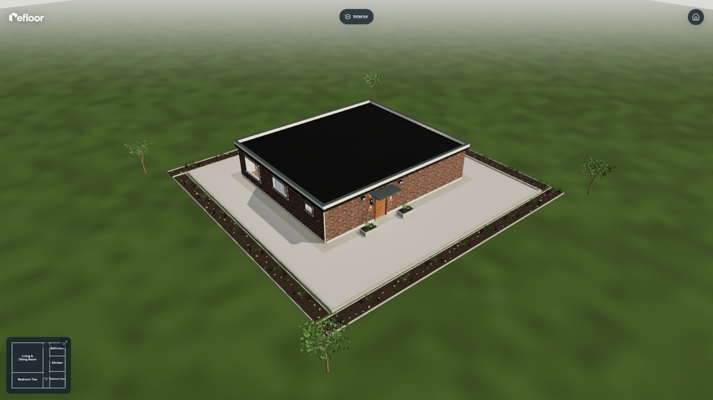
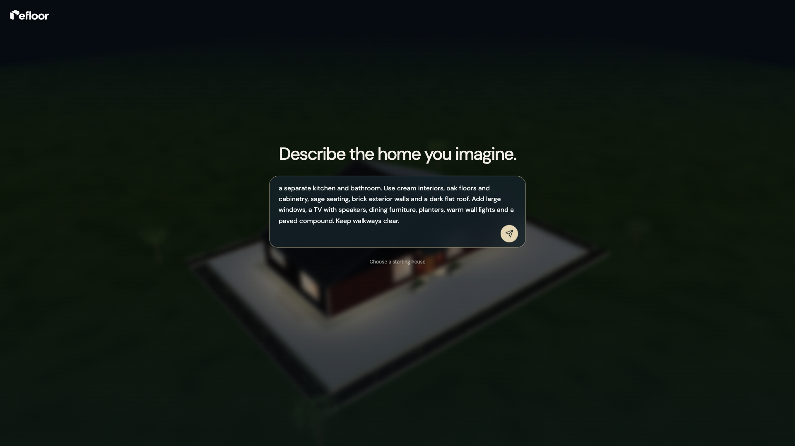
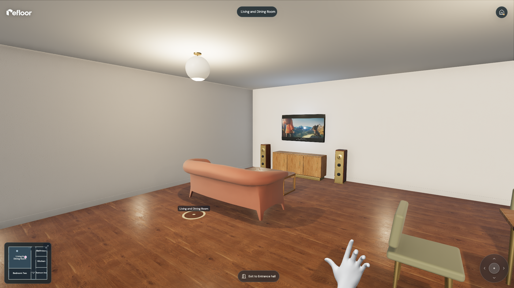
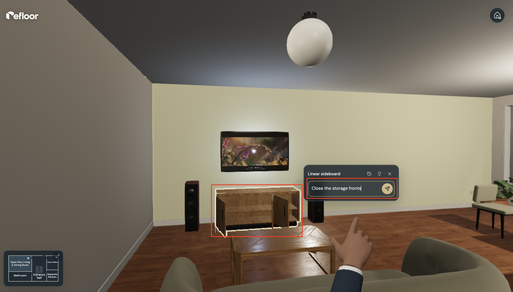
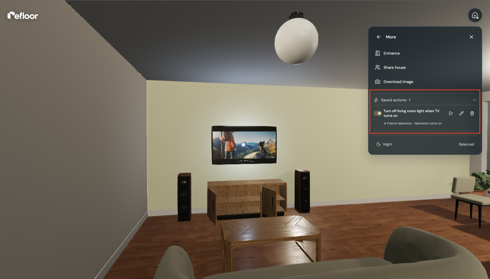
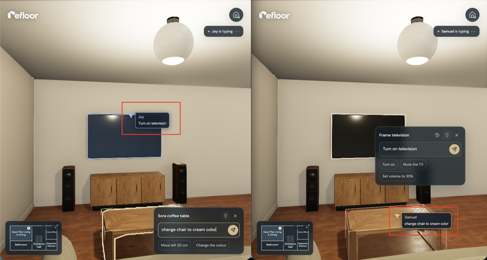
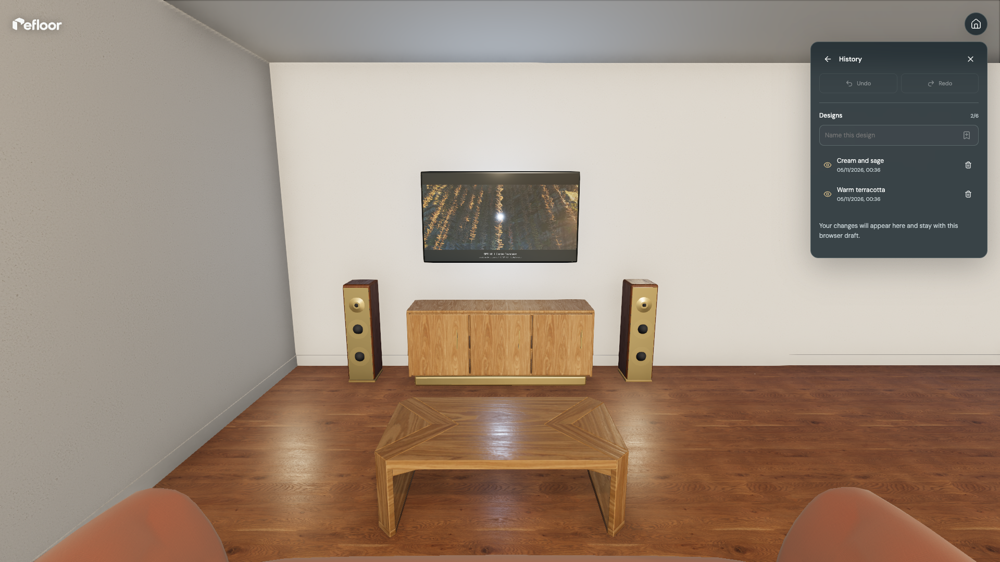

# Refloor

Refloor turns a home brief into a furnished 3D house you can explore room by room. Describe the layout and finishes you want, then ask for changes to materials or furniture as you look around.

Open doors and cupboards, switch on lights, or use the cooker and taps. Save designs, undo edits, and invite others to explore or edit the same home with you.

[](docs/screenshots/bungalow.png)

## What you can do

### Create a home from a description

Describe the rooms you need, how they should connect and the finishes you have in mind. Refloor uses that brief to create a furnished bungalow or two-storey home, with doors, windows and routes between rooms.

You can ask for details such as an open living and dining area, a separate kitchen, brick exterior walls or oak floors. Start from a prepared house if you want to explore first, then make it your own through editing.

[](docs/screenshots/create-home.png)

### Walk through the home

Enter through the front door and explore at room level. Use the room links or house map to move between spaces, or walk with the keyboard and on-screen movement control. Drag the scene to look around as you go.

This lets you see furniture, openings and walkways from inside the home. You can also switch to an exterior overview to inspect the building and compound, then return indoors to continue exploring.

[](docs/screenshots/explore-home.png)

### Redesign through conversation

Select an item or surface and describe the change you want. Ask for terracotta upholstery on a sofa, a different floor finish or a new furniture position. The conversation stays attached to the selected part, so you can keep refining it in context.

Use house chat for changes across the home, and the furniture library to add pieces to a chosen room. Changes are checked before they are applied, and undo lets you step back when an idea does not work for you.

[](docs/screenshots/edit-home.png)

### Make the home respond

The home has working objects you can operate. Open doors and cupboards, switch on lights, play the television, use the cooker and run the taps. Control the TV’s power and volume, or adjust water flow and temperature.

You can also describe connections between actions. For example, ask the television to turn on when you enter the living room. These connections appear in Saved actions, where you can inspect, test, edit, disable or remove them.

[](docs/screenshots/interactions.png)

### Design together

Create an invitation and choose whether someone can edit the home or view it. Each person keeps their own camera and walking position while working with the same design.

You can see who is present, which items they select and when they are typing or applying a change. Accepted changes sync to everyone in the house. The owner can change permissions or remove access from the sharing panel.

[](docs/screenshots/collaborate.png)

### Keep and revisit your designs

The browser keeps your current draft as you edit, while saved homes let you return to different projects. Within a home, named designs keep an arrangement before you try another idea. View or restore one later, or use undo and redo for individual changes.

You can also export a project file and import it again. The file keeps the editable home, saved designs and conversations together, so you can return to it later or keep a portable copy.

[](docs/screenshots/save-designs.png)

## How it works

GPT-6 Luna interprets a home description as room requirements and design choices. Z3 solves the room layout, and Refloor's scene engine assembles the building and checks furniture placement, door clearance and access between rooms. The browser renders the result as an interactive 3D scene.

Later instructions become changes to that scene. Refloor validates them before applying them and records the information needed to undo them. Room entry and device changes can trigger the actions saved with the home.

MongoDB stores saved homes and their history. Socket.IO keeps collaborators connected to the same shared design.

## Run locally

You need Node.js 24 and pnpm 12.3.4.

Install the dependencies and create your environment file.

```sh
pnpm install --frozen-lockfile
cp .env.example .env
```

Set `OPENAI_API_KEY` in `.env` to enable home generation and AI editing. Prepared houses and direct device controls let you explore the app without making AI requests.

Start the database in one terminal. On its first run, this command downloads MongoDB and starts a local replica set.

```sh
pnpm db:dev
```

Start the API in a second terminal.

```sh
pnpm dev:server
```

Start the client in a third terminal, then open [localhost:5173](http://localhost:5173).

```sh
pnpm dev
```

Run `pnpm check` to check formatting, linting, rendering assets, production builds, types and automated tests.

## Built with

| Area                   | Technologies                                      |
| ---------------------- | ------------------------------------------------- |
| Browser studio         | TypeScript, React, Three.js and React Three Fiber |
| Movement and collision | Rapier                                            |
| Generation and layout  | GPT-6 Luna and Z3                                 |
| API and storage        | Fastify and MongoDB                               |
| Live collaboration     | Socket.IO                                         |

## Credits

Materials, furniture models and HDR lighting use assets from [Poly Haven](https://polyhaven.com/license) and [ambientCG](https://docs.ambientcg.com/license/) under CC0.

The hand model comes from [WebXR Input Profiles](https://github.com/immersive-web/webxr-input-profiles/tree/main/packages/assets) under the MIT licence.

The TV plays a resized, letterboxed excerpt from [Spring](https://studio.blender.org/projects/spring/pages/about/), by Andy Goralczyk, © Blender Foundation, under [CC BY 4.0](https://creativecommons.org/licenses/by/4.0/).
